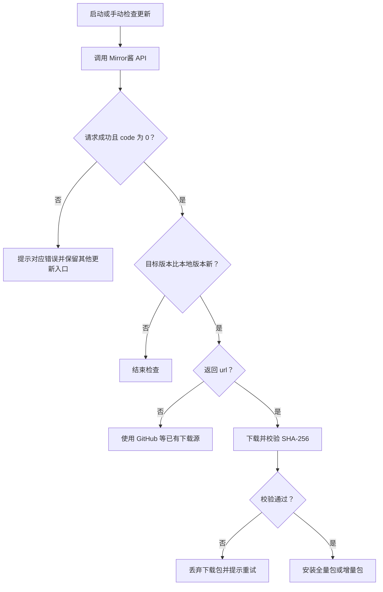

# 自研客户端集成指南

[返回首页](./README.md) · [快速开始](./QuickStart.md) · [完整 API 文档](https://apifox.com/apidoc/shared-ffdc8453-597d-4ba6-bd3c-5e375c10c789/253583257e0)

本页适用于有自己界面和更新代码的客户端。通用 GUI 项目可直接使用[配置接入](./QuickStart.md#通用-gui-项目)，无需重复实现更新器。

我们会随接入 PR 或交付说明提供 RID、发布包与平台映射、请求 URL 示例。按[快速开始](./QuickStart.md#自研客户端)使用示例确认响应后，再将下列流程接入客户端；具体交互可按项目调整。

## 设置项

- 提供 CDK 输入框，掩码显示，允许用户留空。
- 提供 [Mirror酱](https://mirrorchyan.com)网页入口，可通过 `source` 记录[来源](./README.md#付费源)。
- 复用项目已有的设置存储；避免 CDK 明文进入日志、配置导出、遥测或崩溃报告。

CDK 通过 query 参数发送，记录 HTTP 日志时需要脱敏，不能输出完整请求 URL。上传 Token 仅保存在 CI 的 secret 中，不放入客户端。

## API 接口

```text
GET https://mirrorchyan.com/api/resources/{res_id}/latest
```

### 请求参数

| 参数 | 位置 | 是否需要 | 说明 |
| --- | --- | --- | --- |
| `res_id` | path | 必填 | 官方分配的资源 ID（RID） |
| `current_version` | query | 按包型 | ZIP 增量更新传当前本地版本，与上传版本名保持同一格式，如统一带 `v`；请求完整包时留空，APK / EXE 安装包留空 |
| `cdk` | query | 可选 | 用户 CDK；未填写时不传，仍可检查版本 |
| `os` | query | 按资源配置 | 常用规范值：`windows`、`linux`、`darwin`、`android`；不区分系统时不传 |
| `arch` | query | 按资源配置 | 常用规范值：`386`、`amd64`、`arm`、`arm64`；不区分架构时不传 |
| `channel` | query | 可选 | `stable`（默认）、`beta`、`alpha`，按项目发布约定选择 |
| `user_agent` | query | 可选 | 客户端来源标识，如 `myapp_desktop`；`mirrorchyan_web` 为保留值 |

使用 HTTP 库的 query 编码功能构造参数。`os` / `arch` 必须与上传资源的配置匹配，不能一律附上本机平台；不区分平台的资源带上平台参数也可能返回 404。

`channel=stable` 只查询正式版；`beta` 在正式版和测试版中选择较新版本；`alpha` 在三个通道中选择最新版本。不要为消除 404 而直接把所有用户切换到 `alpha`。

### 成功响应

当 `code == 0` 时，读取 `data`。以下为常用字段，下载相关字段可能不出现；完整字段以 [API 文档](https://apifox.com/apidoc/shared-ffdc8453-597d-4ba6-bd3c-5e375c10c789/253583257e0)为准。

| 字段 | 用途 |
| --- | --- |
| `version_name` | 最新版本号，成功检查版本时返回，用于与本地版本比较 |
| `release_note` | 更新日志，在确认有新版本后展示 |
| `url` | 带时效的下载地址，有可用更新且 CDK 有效时返回；取得后尽快下载，不持久缓存 |
| `sha256` | 当前返回的下载包的 SHA-256，用于安装前校验 |
| `filesize` | 当前下载包的大小（字节），可用于显示进度 |
| `update_type` | `incremental` 或 `full`；ZIP 更新需兼容两种包，APK / EXE 等安装包按完整包处理 |
| `channel` / `os` / `arch` | 本次查询的通道、系统和架构 |
| `custom_data` | 开发者上传时附带的自定义数据 |
| `cdk_expired_time` | CDK 到期时间戳，可用于展示到期提示 |

**不能用 `url` 是否存在判断有没有更新。** 未填写 CDK 时不会返回下载地址，但仍可能有新版本。先比较 `version_name`，再决定下载源。

### 失败响应

同时检查 HTTP 状态和 JSON 中的 `code`。HTTP 非 2xx 时，若响应是 JSON，也应尝试读取业务错误码；网络超时、空响应或非 JSON 响应则按网络 / 服务异常处理。

```json
{
  "code": 7002,
  "msg": "KEY_INVALID"
}
```

上例仅用于说明错误结构，实际 `msg` 文案以接口返回为准。各错误码的用户提示和处理建议见[错误代码表](./ErrorCode.md)。

## 检查更新流程



1. 异步检查，设置合理的超时；失败不应阻塞启动或导致崩溃。启动时和用户手动操作时检查即可，避免高频轮询。
2. 按项目的版本规则比较。使用 [SemVer](https://semver.org/lang/zh-CN/) 时处理 `v` 前缀和预发布版本，不要直接比较字符串大小，也不要把不相等一律视为升级。
3. 有新版本但没有 `url` 时，使用项目原有下载源，并允许用户填写 CDK 使用 Mirror酱 下载。
4. CDK 错误时给出[明确提示](./ErrorCode.md)，允许用户修正或选择其他更新渠道；网络失败时可回退到项目已有更新机制。
5. 当前平台或通道无包（8001）时，提示「当前平台暂无可用更新」，保留其他更新入口；开发阶段按 [FAQ](./FAQ.md#返回-404code-8001怎么排查)排查。

## 下载与安装

先按接入方案确认包型：ZIP 资源可使用 `current_version` 选择可用增量包，留空则请求完整包；APK、EXE 等安装包始终按完整包下载安装，不进入 `changes.json` 的解压覆盖流程。

1. 从响应中的 `url` 下载，支持 HTTP 重定向。下载失败时检查 HTTP 状态；有 JSON 错误体时解析 `code` / `msg`，否则显示可重试的下载失败提示。
2. 使用本次响应中的 `sha256` 校验下载包，失败则丢弃，不执行安装。不要把其他来源的包与 Mirror酱 返回的哈希混用。
3. 链接过期时重新请求版本接口获取地址，避免反复重试同一失效链接。
4. ZIP 等归档包先解压到临时目录，在写入每个条目前校验目标路径和链接，再校验 `changes.json`，之后才修改安装目录。完整归档包按项目原有策略安装；增量包按[增量更新指南](./Incremental.md)处理删除项和覆盖文件。APK、EXE 则交给对应的安装流程。
5. 在更新成功后记录新版本。若增量更新中断导致目录混有新旧文件，应恢复完整旧版本，或改用干净的全量安装恢复，不能仅保留旧版本号后继续叠加增量包。

资源版本命中并不保证一定返回增量包，客户端始终以本次响应的 `update_type` 为准。程序正在运行时，使用项目已有的更新进程或退出后替换方案，不要假设被占用文件总能删除或重命名。

## 上线前验收

使用官方确认的资源、版本和测试信息完成以下检查，包型相关项按项目实际情况验证，CDK 和 Token 不写入测试记录：

- [ ] 不填 CDK：成功获取版本信息；有更新但无 `url` 时，可以使用原有下载源。
- [ ] 有效 CDK + 真实旧版本：能下载、校验并完成更新。
- [ ] 已是最新版本或本地版本更高：不重复更新，不自动降级。
- [ ] 错误 / 过期 CDK：提示原因，用户仍能选择其他更新渠道。
- [ ] 断网、超时或非 JSON 响应：不阻塞启动，不崩溃。
- [ ] 当前平台 / 通道无包（8001）：有合适提示和备用更新入口。
- [ ] 下载损坏：哈希校验失败，不安装；下载链接过期后可重新获取。
- [ ] ZIP 更新：全量包和增量包均可安装，删除项被正确处理；中断后可恢复完整版本。
- [ ] ZIP 更新：解压条目在写入前校验，`changes.json` 中的越界路径被拒绝。
- [ ] APK / EXE 更新：完整安装包可以交给对应安装流程，无需处理增量删除项。
- [ ] 日志、配置导出和崩溃报告中不包含 CDK、上传 Token 或完整下载链接。

基本流程通过后，再按需配置[来源统计](./README.md#来源统计)。后续发版使用接入 PR 中已适配的[自动化上传](./README.md#自动化上传)。
