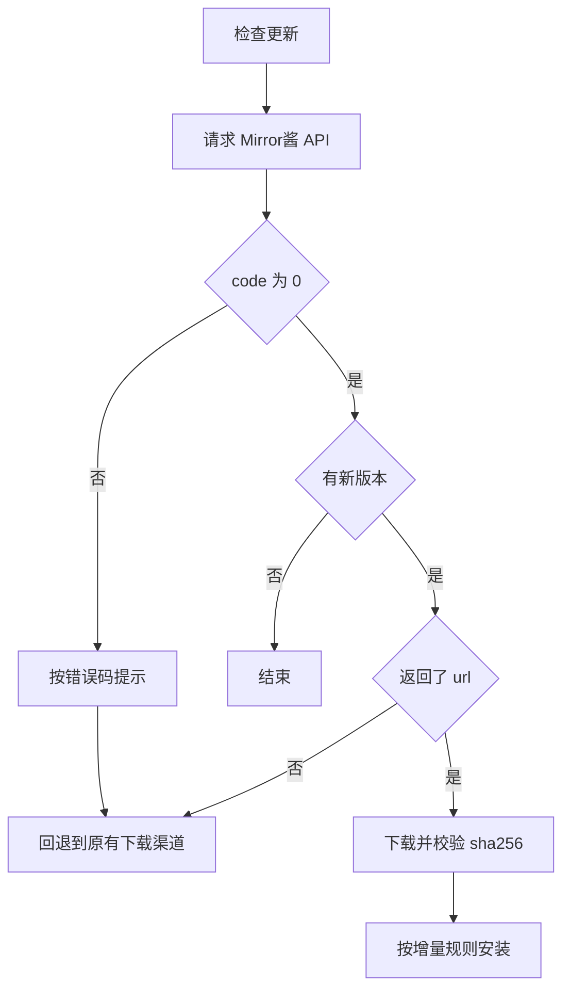

# Mirror酱服务集成指南

Mirror酱给开源应用提供更新检查，以及可选的高速下载。

- 资源 ID（`res_id`）由项目接入时分配。不要用仓库名、项目名，或下文示例里的 `M9A` 自行填写。
- 未填写 CDK 时也可以调用检查更新接口。此时返回最新版本号，不返回下载地址，客户端继续使用原有渠道（如 GitHub）。
- CDK 有效且存在新版本时，返回带时效的下载地址。地址不要缓存，拿到后尽快下载。
- CDK 在请求 URL 的 query 里。日志、崩溃报告、遥测和导出的配置中不要记录 CDK，也不要记录完整请求 URL。

用 AI 编程助手接入时，可以安装本仓库的 [Agent Skill](./.agents/skills/mirrorchyan-integration/SKILL.md)：

```bash
npx skills add MirrorChyan/docs
```

也可以把该文件链接发给 AI。没有官方资源 ID 时，Skill 会停下来，不会改仓库。

## 接入方式

### 通用 GUI

使用 [MXU](https://github.com/MistEO/MXU)、[MFAAvalonia](https://github.com/MaaXYZ/MFAAvalonia)、[MaaFwApp](https://github.com/Aliothmoon/MaaFwApp) 等 MaaFramework 通用 GUI 时，检查更新、CDK 输入和下载安装已经内置。

把仓库地址发给[项目接入 QQ](#联系我们)。我们会提 PR，通常包含：

- 在 `interface.json` 写入 `mirrorchyan_rid` 和 `mirrorchyan_multiplatform`
- 添加发版时自动上传到 Mirror酱 的 workflow

merge 之后，按 [常见问题](./FAQ.md) 在仓库 Actions secrets 里添加 `MirrorChyanUploadToken`。

不要自己实现更新逻辑，也不要自己编写上传 workflow。资源 ID，以及 `os`、`arch`、`channel` 的划分，以 PR 和接入时告知的为准。

这些字段需要和实际上传方式一致：

| 字段 | 说明 |
| --- | --- |
| `mirrorchyan_rid` | 资源 ID，即接口路径里的 `res_id`。只填写接入时提供的值。 |
| `mirrorchyan_multiplatform` | 按系统 / 架构分别上传不同的包时为 `true`，GUI 请求会带上 `os` 和 `arch`。所有平台共用一个包时为 `false` 或不填。和实际上传方式不一致时，检查更新返回 404（code 8001）。 |
| `version` | 项目版本号，GUI 用它作为 `current_version`。发版时需与 Git tag、上传到 Mirror酱 的版本名一致。 |
| `github` | 项目 GitHub 仓库地址。未走 Mirror酱 下载时，用于版本检查和问题反馈。 |

通用 GUI 只更新资源，不单独更新 UI 本体或 MaaFramework。发版时由项目自行打包指定版本的 UI 和 MaaFramework。

同一项目同时发布多个通用 GUI 时，每个 GUI 使用独立的资源 ID，否则增量包会对不上。MaaFwApp 可在 `pi-profile.yaml` 的 `update.mirrorchyanRid` 中单独指定，覆盖 `interface.json`。字段以 [ProjectInterface V2 协议](https://github.com/MaaXYZ/MaaFramework/blob/main/docs/zh_cn/3.3-ProjectInterfaceV2协议.md) 和对应 GUI 的文档为准。

### 自研界面

客户端按下面的接口实现检查更新、下载和安装。上传 workflow 同样由我们提 PR，不要自己写。把仓库地址发给项目接入 QQ，并说明要发布的系统、架构和通道。

下面的流程是推荐做法，文案和行为可以按项目调整。

## API

- **端点**：`GET` `https://mirrorchyan.com/api/resources/{res_id}/latest`
- **接口文档**：[OpenAPI](https://apifox.com/apidoc/shared-ffdc8453-597d-4ba6-bd3c-5e375c10c789/253583257e0)

### 请求参数

| 参数 | 位置 | 必填 | 说明 |
| --- | --- | --- | --- |
| `res_id` | path | 是 | 资源 ID。使用接入时提供的值，不要使用示例值。 |
| `current_version` | query | 推荐 | 当前版本号。需与上传时的版本名格式一致（例如都带 `v`）。一致且可以计算差异时返回增量包，否则返回全量包。推荐 [SemVer](https://semver.org/lang/zh-CN/)。 |
| `cdk` | query | 否 | 用户 CDK。未填写时不要传这个参数。 |
| `os` | query | 视资源而定 | `windows` / `linux` / `darwin` / `android`。也接受 `win`、`macos` 等别名。资源不区分系统时不要传。 |
| `arch` | query | 视资源而定 | `386` / `amd64` / `arm` / `arm64`。也接受 `x64`、`x86_64`、`aarch64` 等别名。资源不区分架构时不要传。 |
| `channel` | query | 否 | `stable`（默认）/ `beta` / `alpha`。见下方通道规则。 |
| `user_agent` | query | 否 | 客户端标识，对应统计面板中的「签到源」。不要使用保留值 `mirrorchyan_web`。 |

`os` / `arch` 要和上传时的划分一致：按平台分别上传的包，请求必须带上对应的 `os` 和 `arch`；不区分平台的包，请求不要带这两个参数。多传、少传或组合不存在时，返回 HTTP 404，`code` 为 8001。

通道：`stable` 只查正式版；`beta` 取正式版和测试版中较新的一个；`alpha` 取三个通道中最新的一个。

```bash
curl -X GET "https://mirrorchyan.com/api/resources/M9A/latest?current_version=v0.0.1&cdk=XXXXX&user_agent=MAA_WPF"
```

`M9A` 只是文档示例，不是你的资源 ID。

### 响应

成功时 HTTP 200，正文为：

```json
{
  "code": 0,
  "msg": "success",
  "data": {
    "version_name": "v1.1.0",
    "url": "https://mirrorchyan.com/resources/download/xxxxxx",
    "release_note": "该版本新增了xxx功能；修复了xxx bug"
  }
}
```

| 字段 | 说明 |
| --- | --- |
| `version_name` | 最新版本号，始终返回。 |
| `release_note` | 版本日志。有新版本时返回。 |
| `url` | 带时效的下载地址。有新版本且 CDK 有效时返回。不要缓存。 |
| `sha256` | 安装包校验值。下载后校验，失败则丢弃，不要安装。 |
| `filesize` | 文件大小，可用于显示进度。 |
| `update_type` | `incremental`（增量）或 `full`（全量）。 |
| `channel` / `os` / `arch` | 这个包对应的通道、系统、架构。 |
| `custom_data` | 上传时附带的自定义数据。 |
| `cdk_expired_time` | CDK 到期时间戳，可用于提示续费。 |

除 `version_name` 外，其余字段按场景出现。没有新版本时不要假定存在 `url`、`release_note` 或 `sha256`。

失败时的 `code` 见 [错误码](./ErrorCode.md)。下载 `url` 时如果 HTTP 状态不是 2xx，响应体仍可能是 JSON，按 `code` / `msg` 提示，不要把正文存成安装包。

## 客户端行为

检查放在启动时和用户手动点击时，不要高频轮询。请求异步执行并设置超时。网络失败、超时或接口返回错误时，不要阻塞启动，也不要导致崩溃，并回退到项目原有的下载渠道。



- 用 SemVer 比较 `version_name` 和 `current_version`，忽略前缀 `v`，并处理预发布版本（如 `1.2.0-beta.1`）。项目不用 SemVer 时不要按字符串比较，先确定比较规则。
- 有新版本但没有 `url`：从 GitHub 等原有渠道下载，并提示可以填写 CDK 使用 Mirror酱 下载。
- CDK 错误（7001–7005）和当前平台没有包（8001）只影响 Mirror酱 下载，用户仍然可以从原有渠道更新。
- 8001 在界面上提示当前平台暂无可用更新即可，不要当成严重错误。日志记录本次请求的 `os`、`arch`、`channel`，不要记录 CDK。

设置界面建议提供：

1. CDK 输入框。持久化保存，界面上掩码显示。
2. 跳转链接，见下方「付费源」。

## 安装更新

1. 下载完成后校验 `sha256`，不一致则删除文件。
2. 解压到临时目录。
3. 若包内有 `changes.json`，在安装目录中删除 `deleted` 列出的文件，以及 `deleted_dir` 列出的目录（含其中的文件）。先删除，再覆盖。字段见 [增量包](./Incremental.md)。
4. 用新文件覆盖安装目录。
5. 待更新的程序正在运行时（常见于 Windows），先把旧文件重命名，写入新文件，下次启动再删除旧文件。重命名不要求文件未被占用。

压缩包条目和 `changes.json` 中的路径都必须落在安装目录之内。拒绝 `..` 和绝对路径。

## 自动化上传

上传用的 workflow 由我们按项目提 PR，在发版时自动上传。不要自己新增 `mirrorchyan_release.yml`，也不要在现有 workflow 里自行添加上传步骤。平台、架构和文件名需要与资源上已登记的一致。

- 资源要增加新的系统或架构时，先联系项目接入 QQ，在 Mirror酱 侧加上。只改 workflow 并看到 Action 成功，官网也不一定出现该平台。
- 同一个资源 ID 不要上传不同 GUI 的包。每个 GUI 单独使用一个资源 ID。

Token 只放在仓库 Actions secret `MirrorChyanUploadToken` 中，不要写入仓库文件。设置方法和名称大小写见 [常见问题](./FAQ.md)。

## 日活统计

统计面板提供不精确的日活，包括检查更新量和下载量，按 IP 去重。

## 来源统计

可选。

### 签到源

在检查更新请求中加 `user_agent`，表示用户从哪个客户端使用 CDK，对应统计面板的「签到源」。

```
https://mirrorchyan.com/api/resources/M9A/latest?current_version=v0.0.1&user_agent=M9A_APP
```

从 [Mirror酱项目一览](https://mirrorchyan.com/zh/projects) 下载时，该值为保留值 `mirrorchyan_web`，客户端不要使用。

### 付费源

在跳转链接上加 `source`，表示用户从哪里打开 Mirror酱 网站，对应统计面板的「付费源」。建议使用 `应用名_位置`，例如：

- `https://mirrorchyan.com/zh/projects?rid=MAA&source=maa_github_release`
- `https://mirrorchyan.com?source=maa_app_settings`

## 验收

通用 GUI：合并官方 PR 并设置 Token 后，在 GUI 里实际检查一次更新。`interface.json` 应能通过 [schema](https://github.com/MaaXYZ/MaaFramework/blob/main/tools/interface.schema.json) 校验。返回 404 时对照 `mirrorchyan_multiplatform` 和上传时的平台划分，不要改资源 ID。

自研界面：

- [ ] 不填 CDK：`code` 为 0，有 `version_name`，没有 `url`，程序回退到原有下载渠道。
- [ ] 填入错误 CDK：返回 7002，界面有明确提示，程序不崩溃，仍可从原有渠道更新。
- [ ] 断网或超时：不阻塞启动，不崩溃。
- [ ] 当前平台或通道没有包（8001）：有明确提示，并回退到原有下载渠道。
- [ ] 已是最新版本：不提示更新。
- [ ] 日志、配置导出和崩溃报告中没有 CDK，也没有完整请求 URL。
- [ ] `user_agent` 和跳转链接的 `source` 已按约定设置。
- [ ] 增量更新会删除 `deleted` 中的文件；路径越界的条目被拒绝。

## 常见问题

Token、多架构和多 GUI 见 [常见问题](./FAQ.md)。

## 联系我们

项目接入 QQ：1751971337  
用户售后 QQ 群：995458883
